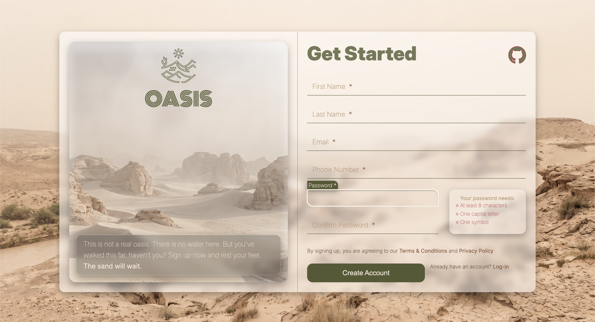

# TOP-Sign-up-form

A sign-up form built with HTML, CSS and JavaScript. No frameworks, no build step.

**[Live demo](https://knshnbz.github.io/TOP-Sign-up-form/)**

---

## About

The Odin Project's sign-up form assignment, built out as a complete page: a
two-panel layout with a desert hero on one side and the form on the other.
The focus was on form UX — labels that float, password rules that confirm
themselves as you type, and validation that explains itself.

## Features

- **Floating labels** — pure CSS, driven by `:has()` and `:placeholder-shown`
- **Live password checklist** — each requirement turns green as it is met
- **Hint panel** — slides in while either password field has focus, and takes
  up no layout space when closed
- **Password confirmation** — mismatches surface through the same error styles
  as the browser's own validation
- **Blocked submission** — the form will not submit until every rule passes
- **Responsive** — side-by-side above 900px, stacked below
- **Animated SVG logo** — drawn in on load with `stroke-dasharray`

## Built with

- Semantic HTML
- CSS: custom properties, cascade layers, `oklch()` colors, `clamp()` type scale
- Vanilla JavaScript (no dependencies)
- [Inter](https://fonts.google.com/specimen/Inter) and
  [Monoton](https://fonts.google.com/specimen/Monoton) from Google Fonts

## What I learned

**Cascade layers.** Splitting the stylesheet into `reset`, `layout`, `container`,
`hero` and `form` layers removed every specificity fight. The catch learned the
hard way: unlayered CSS beats *all* layers, so a reset outside a layer silently
overrides everything inside one.

**`:has()` for state.** The floating labels and the hint panel are both driven by
`:has()` on a parent — no JavaScript class toggling. Keeping presentation state
in CSS and data state in JavaScript cut the script roughly in half.

**Transitioning `display`.** An element hidden with `display: none` can't be
faded in — the transition never runs. `transition-behavior: allow-discrete`
plus `@starting-style` solves it, which is how the hint panel animates while
still taking no space when closed.

**The Constraint Validation API.** `setCustomValidity()` turns a custom rule into
a real validation error: it blocks submission and makes the field match
`:user-invalid`, so the error styling that was already written lights up on its
own. Passing an empty string clears it — forgetting that leaves a field
permanently invalid.

**`:user-invalid` over `:invalid`.** `:invalid` fires on page load, so every
empty required field is red before the user has done anything.
`:user-invalid` waits for interaction.

**Fluid type needs a `rem` term.** `clamp(1rem, 0.9rem + 0.4vw, 1.25rem)` —
a middle value made only of `vw` ignores the user's own font-size setting.

## Credits

- Assignment from [The Odin Project](https://www.theodinproject.com/)
- Hero images generated by me with AI
- Desert logo from [SVG Repo](https://www.svgrepo.com/svg/136082/desert) (CC0)
- Fonts: [Inter](https://fonts.google.com/specimen/Inter) and
  [Monoton](https://fonts.google.com/specimen/Monoton) (Google Fonts, OFL)